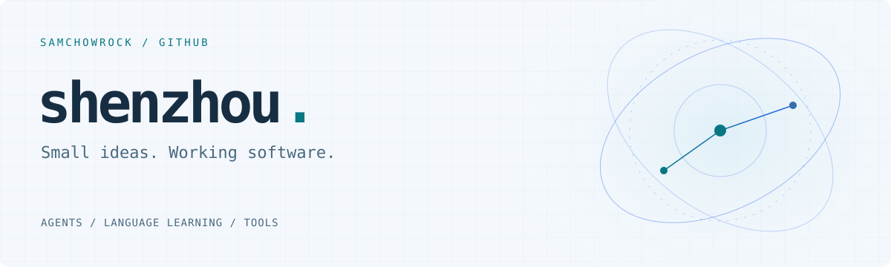

<picture>
  <source media="(prefers-color-scheme: dark)" srcset="./assets/header-orbital.svg" />
  <source media="(prefers-color-scheme: light)" srcset="./assets/header-orbital-light.svg" />
  
</picture>

<h2>👋 Hey, I’m shenzhou</h2>

Also known as <strong>SamChowRock</strong>. I build tools for everyday problems. 🛠️

🌱 Currently building <strong>EPP</strong> — bringing English expression collection and practice into everyday agent conversations. 💬

<h2>🧰 My toolbox</h2>

<picture>
  <source media="(prefers-color-scheme: dark)" srcset="./assets/typescript.svg" />
  <source media="(prefers-color-scheme: light)" srcset="./assets/typescript-light.svg" />
  
</picture>
<picture>
  <source media="(prefers-color-scheme: dark)" srcset="./assets/nodejs.svg" />
  <source media="(prefers-color-scheme: light)" srcset="./assets/nodejs-light.svg" />
  
</picture>
<picture>
  <source media="(prefers-color-scheme: dark)" srcset="./assets/mcp.svg" />
  <source media="(prefers-color-scheme: light)" srcset="./assets/mcp-light.svg" />
  
</picture>
<picture>
  <source media="(prefers-color-scheme: dark)" srcset="./assets/codex.svg" />
  <source media="(prefers-color-scheme: light)" srcset="./assets/codex-light.svg" />
  
</picture>
<picture>
  <source media="(prefers-color-scheme: dark)" srcset="./assets/wechat.svg" />
  <source media="(prefers-color-scheme: light)" srcset="./assets/wechat-light.svg" />
  
</picture>

<h2>🚀 Selected projects</h2>

<table>
<thead><tr><th align="left">Project</th><th align="left">What it does</th></tr></thead>
<tbody>
<tr><td><picture>
  <source media="(prefers-color-scheme: dark)" srcset="./assets/project-agent.svg" />
  <source media="(prefers-color-scheme: light)" srcset="./assets/project-agent-light.svg" />
  
</picture> <a href="https://github.com/SamChowRock/epp-agent-integration"><strong>epp-agent-integration</strong></a> Agent · Skills · MCP</td><td>Record and practice English expressions in agent conversations, with plugins, Skills, and MCP connection tooling.</td></tr>
<tr><td><picture>
  <source media="(prefers-color-scheme: dark)" srcset="./assets/project-contracts.svg" />
  <source media="(prefers-color-scheme: light)" srcset="./assets/project-contracts-light.svg" />
  
</picture> <a href="https://github.com/SamChowRock/epp-contracts"><strong>epp-contracts</strong></a> TypeScript · Zod</td><td>Shared API schemas and TypeScript types that keep EPP clients speaking the same language.</td></tr>
<tr><td><picture>
  <source media="(prefers-color-scheme: dark)" srcset="./assets/project-starmap.svg" />
  <source media="(prefers-color-scheme: light)" srcset="./assets/project-starmap-light.svg" />
  
</picture> <a href="https://github.com/SamChowRock/epp-mini-program"><strong>epp-mini-program</strong></a> WeChat · Mini Program</td><td>A native WeChat mini program for exploring expression star maps and explicitly confirming website logins.</td></tr>
</tbody>
</table>

<h2>🧭 What I’m exploring</h2>
<ul>
<li>🤖 <strong>Agent workflows</strong> — connecting tools and Skills to real tasks.</li>
<li>📚 <strong>Language learning</strong> — collecting useful expressions and practicing them in conversation.</li>
<li>🔗 <strong>Connected experiences</strong> — linking agents, the web, and WeChat through shared contracts.</li>
</ul>

✨ Start with a small problem. Build something useful. Keep iterating. 🚀

